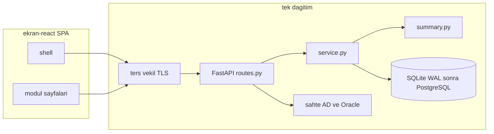

# 01 ? Genel mimari

Durum tarihi: 2026-10-03 (Europe/Istanbul). Bu dosya tasarimdir. Mevcut dosyalari tasimaz ve yeniden adlandirmaz.

## Kararlar

- Tek dagitimli moduler monolit. Mikroservis yok. Kaynak: onayli yigin ve `dokuman/TEKNOLOJI_ANALIZI.md`.
- Hedef calisma zamani: FastAPI, Python 3.12, Pydantic v2, SQLAlchemy 2, Alembic. Bugunku v3.5 kodu bu degil: `backend/api.py` Flask `create_app` icerir (906 satir). `backend/app/` yok.
- Arayuz hedefi: React 19 + TypeScript + Vite SPA. SSR/Next.js yok. Bugunku `ekran-react` Vite SPA'dir; `App.tsx` yalniz `App1` cizer.
- Oracle canliya baglanilmaz. Tasarimda sahte (fake) adaptordur. Prod kodda `backend/app/api_services.py` `ONEDESK_DB`, `URUNTUTAR_DB`, `ONENTDB_DB` siniflari vardir; v3.5 bunlari acmaz (`api.py` basligi: "Oracle acilmaz").
- AD/LDAP canliya baglanilmaz. Prod `ad_service.py` `ADAuthService` tasir. v3.5 `api.py` icinde `_AD` sinifi vardir; bu belgeler onu cagiran yeni kod yazmaz.
- Veri simdi SQLite, faz 4'te PostgreSQL. Ayrinti `05-veri-mimarisi.md`.
- Kimlik: HttpOnly + SameSite oturum cerezi, hiz siniri, denetim kaydi. Ayrinti `06-guvenlik-yetki.md`.

## Acik sorular

- Windows hizmeti (service) kurulum betigi bu taramada dogrulanmadi. Prod giris `server.py` (Waitress) + `start_server.bat` / `yonet.bat`.
- Hedef surec sayisi: prod ciftlik (`SUNUCU_SURECLERI`) SQLite tek yazici notuyla sinirlidir (`server.py`). Tek uvicorn mu, sinirli isci mi ? karar yok.
- `dokuman/MIGRASYON_PLANI.md` ve `dokuman/MIMARI_AGAC.md` v3.5 altinda yok.

## Katmanlar

Istek yukaridan asagiya iner. Yatay ok yalniz sozlesme veya ozet fonksiyonudur; baska modulun tablosu degil (`03-modul-sozlesmesi.md`).

| Katman | Hedef yer | Isi | Burada olmaz |
|---|---|---|---|
| Arayuz | `ekran-react` | Sayfa, tablo, form, sozluk | SQL, oturum sirr?, Oracle |
| HTTP | `routes.py` | Yol, yetki kapisi, status kodu | Is kurali, baska modul tablosu |
| Sema | `schemas.py` | Pydantic v2 giris/cikis | Flask request, dosya yolu |
| Servis | `service.py` | Is kurali, kendi tablosu | HTTP, baska modul tablosu |
| Ozet | `summary.py` | Baska modulun okuyacagi dar ozet | Yazma, ham satir dondurmek |
| Katalog | `catalog.py` | Modul bayraklari, sira, rol agaci | Satir verisi |
| Cekirdek | `core/` | Oturum, hata modeli, denetim, hiz siniri | Modul is kurali |
| Veri kapisi | `data/gateway.py` | Engine, oturum fabrikasi, WAL | Modul SQL'i dagitmak |
| Adapt?r | `adapters/` | Sahte AD, sahte Oracle | Gercek host, gercek sifre |
| Arayuz kabugu | `src/shell` | Yerlesim, menu, bos/yukleniyor/hata | Modul hesabi |

Prod karsiligi (dogrulandi, tasinmayacak): Flask blueprint `backend/app/blueprints/*.py`, yetki `backend/app/moduller.py`, kutucuk `backend/app/kutucuklar/`, ortak servisler `backend/app/*.py`. v3.5'te bu agac yok; hepsi `backend/api.py` + `backend/depo.py`.

## Bilesen diyagrami

## Istek akisi

1. Tarayici yalniz TLS ucuna gider. Saglik ucu haric duz HTTP, prod'da oldugu gibi, hedefte de uygulamaya birakilmaz.
2. Ters vekil `X-Forwarded-Proto` uretir. Istemcinin gonderdigi `X-Forwarded-*` silinir. Prod'da bu kural `isletim/dagitici.py` basliginda yazilidir.
3. `core/session.py` cerezi okur. Cere yoksa 401. Modul kapisi kataloga bakar. Yetkisizse 403 ve denetim satiri (`guven` veya cekirdek audit; tablo sahibi `05`).
4. `routes.py` govdeyi `schemas.py` ile dogrular. Gecersizse 422, kod `TL-VAL-01` ailesi (`07-api-tasarimi.md`). Ham istisna metni donmez. Prod `hatalar.py` ayni kurali koyar.
5. `service.py` yalniz kendi tablolarina yazar. Baska modul lazimsa onun `summary.py` fonksiyonunu cagirir.
6. Cevap `{"status","data"}` veya hata modeli. Liste uclari sayfalama tasir (`07`).

## Dagitim

Hedef (tasarim, henuz dosyasi yok):

- Bir Windows hizmeti tek paketi baslatir: API sureci + statik SPA dosyalari ayni makinede, ayni s?r?m numarasi.
- Hizmet `127.0.0.1` dinler. Disari yalniz ters vekil acilir.
- TLS vekilde biter. Sertifika ve ozel anahtar belgeye, repoya ve SQLite'a yazilmaz. Prod'da yol `.env` icindedir; bu tarama `.env` okumadi.
- Saglik: hedef `GET /api/v1/health`. Prod bugun `GET /api/health`. v3.5 bugun `GET /api/saglik` (Flask, `/api/v1` degil).

Prod'da dogrulanan isletim (hedef degil, referans):

- `server.py`: Waitress. Varsayilan `WAITRESS_PORT` 80, ciftlikte `127.0.0.1` ve taban port 8081. Is parcacigi tavan notu 6.
- `isletim/dagitici.py`: port 80, en az acik istek, 5 sn'de bir `/api/health`. Belge IIS/ARR'nin 2026-09-19'da kaldirildigini soyler.
- `isletim/tls_vekili.ps1`: http.sys 443, hedef `127.0.0.1` vekil portu. Python TLS cozmez; anahtar disa aktarilamaz sertifika icin yazilmis.
- `depo_yollari.py`: varsayilan kok `C:\Secure_DB` (Windows). Bu belgelerdeki sayimlar `D:\Project\TAM_Life\Secure_DB` kopyasidir, canli kok dogrulanmadi.

v3.5 bugun: Flask `backend/api.py`, CORS yalniz `http://127.0.0.1:5173` ve `http://localhost:5173`. `ekran-react/src/lib/api.ts` `API_KOK = "http://127.0.0.1:8119"`. `package.json` script `api:uret` ise `http://127.0.0.1:8118/api/v1/openapi.json` arar. Bu iki port dizesi dosyada vardir; dinleyen surec bu taramada dogrulanmadi. OpenAPI ureten FastAPI uygulamasi yok.

## Bugunku calisma zamani (hedef degil)

Prod `backend/app/__init__.py` sirasi dogrulandi: Jinja'ya `ANA_SAYFA_KUTUCUKLARI`, `ALT_KUTUCUKLAR` (bos), `KUTUCUK_EYLEMLERI` (bos), `KUTU_DISI_EYLEMLER` (bos) verilir. Blueprint kaydi: `auth_bp`, `dashboard_bp`, `topology_bp`, `operations_bp`, `projects_bp`, `admin_bp`, `customer_bp`, `talep_bp`, `veri_bp`, sonra `workspace_bp`, `workspace_api_bp`, `integrations_bp`. Ardindan `GET /api/health` ve `kutucuklar.registry.register_all`. Yorum: "dashboard henuz ozet_hepsi kullanmiyor"; `register` govdeleri `return None`.

`/api/health` `MODUL_TABLOLARI` uzerinden salt okunur yoklar. Anahtar basina `OK` veya `HATA`. `gelir_uretim`, `toptan`, `baglantili` bu sozlukte yok. `onedesk` yoklanan tablo `customers` (analiz.db degil). `takvim` ve `takvim_ozet` ikisi de `calendar_records`.

v3.5 `create_app` Flask'tir. CORS yalniz iki origin. `depo.hazirla` bes sqlite dosyasini ve `veri/gelen` klasorunu acar; bu taramada `gelen` altinda dosya listelenmedi. `backend-api/app.py` yok. `dokuman/MIGRASYON_PLANI.md` ve `dokuman/MIMARI_AGAC.md` yok. `dokuman/TEKNOLOJI_ANALIZI.md` var (4399 bayt) ve ayni yigini onerir; ASP.NET/Java/Next/mikroservis yedek secenek olarak yazilidir, bu belge onlari sunmaz.

Hedef surec: hizmet 127.0.0.1, vekil TLS. Prod referans vekil `isletim/tls_vekili.ps1` (http.sys 443 -> yerel port) ve `isletim/dagitici.py` (80, least-requests, saglik 5 sn). IIS 2026-09-19 notuyla kaldirilmis. Windows service birimi dosyasi bu taramada yok: dogrulanmadi.
